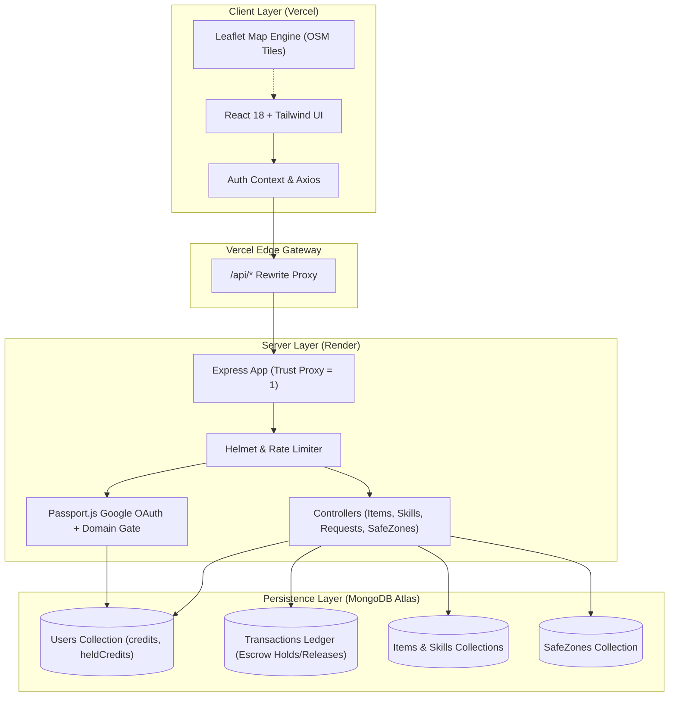

# CampusSphere 🎓🤝

**A hyper-gated student marketplace & cashless skill-barter network**

[](https://opensource.org/licenses/MIT)
[](https://nodejs.org/)
[](https://react.dev/)
[](https://vitejs.dev/)
[](https://tailwindcss.com/)
[](https://expressjs.com/)
[](https://www.mongodb.com/)
[]()

CampusSphere is a domain-gated, peer-to-peer campus platform engineered for verified college communities. It solves on-campus trust, waste, and access problems by allowing students to buy, sell, or rent hostel gear (irons, kettles, textbooks, engineering drafters) and barter academic skills using cashless Campus Credits protected by a two-party escrow ledger and physical safe-handover zones.

---

## 📸 Demo

> [ADD: Insert project hero banner or preview GIF here]

* **Live Frontend:** [https://campus-sphere.vercel.app](https://campus-sphere.vercel.app) `[ADD: Update with your exact deployed Vercel URL if different]`
* **API Health Endpoint:** [https://campus-sphere-api.onrender.com/api/health](https://campus-sphere-api.onrender.com/api/health) `[ADD: Update with your Render URL]`

| Landing & Stats | Safe Zones Map | Marketplace Listings |
| :---: | :---: | :---: |
| `[ADD: Screenshot / GIF - Landing Page]` | `[ADD: Screenshot / GIF - Leaflet Map]` | `[ADD: Screenshot / GIF - Marketplace]` |

---

## 📑 Table of Contents

- [About the Project](#-about-the-project)
  - [Live Deployed Application](#-live-deployed-application)
  - [The Problem](#the-problem)
  - [The Solution](#the-solution)
  - [What Makes It Different](#what-makes-it-different)
- [Features](#-features)
- [Tech Stack](#-tech-stack)
- [System Architecture](#-system-architecture)
- [Project Structure](#-project-structure)
- [Getting Started](#-getting-started)
  - [Prerequisites](#prerequisites)
  - [Installation](#installation)
  - [Environment Variables](#environment-variables)
  - [Running Locally](#running-locally)
- [Usage & API Reference](#-usage--api-reference)
- [Testing](#-testing)
- [Deployment](#-deployment)
  - [Backend Deployment (Render)](#backend-deployment-render)
  - [Frontend Deployment (Vercel)](#frontend-deployment-vercel)
- [Roadmap](#-roadmap)
- [Contributing](#-contributing)
- [Team & Acknowledgements](#-team--acknowledgements)
- [License](#-license)
- [Contact & Links](#-contact--links)
- [Missing Information Checklist](#-missing-information-checklist)

---

## 💡 About the Project

### 🌐 Live Deployed Application

| Service | Status | Live URL |
| :--- | :---: | :--- |
| **Frontend Application (Vercel)** | 🟢 Online | **[https://campus-sphere.vercel.app](https://campus-sphere.vercel.app)** |
| **Backend REST API (Render)** | 🟢 Online | **[https://campus-sphere-api.onrender.com/api/health](https://campus-sphere-api.onrender.com/api/health)** |
| **GitHub Repository** | 📦 Public | **[https://github.com/vanshikayadav6153-ai/campus-sphere](https://github.com/vanshikayadav6153-ai/campus-sphere)** |

> [!NOTE]
> If you have custom domain deployment links (e.g. `https://campussphere.yourcollege.ac.in`), replace the placeholders above with your custom domain.

### The Problem
Campus life suffers from three structural inefficiencies:
1. **Trust Gap:** Open public marketplaces (OLX, Facebook Marketplace) expose students to unknown actors, fraud risks, and unmonitored off-campus meetups.
2. **Usable Waste:** Graduating students regularly discard functional hostel essentials (irons, electric cookers, lab coats, semester textbooks) because no trusted internal channel exists to pass them down.
3. **Blocked Access:** Private tutoring and commercial courses are expensive, locking peers out of academic mentoring even though student talent already exists on campus.

### The Solution
CampusSphere establishes an internal, zero-trust campus economy restricted strictly to verified institutional email addresses (`@college.ac.in`). It combines a circular gear marketplace with a cashless, time-backed skill-barter network settled in **Campus Credits**.

### What Makes It Different
* **Hyper-Gated Security:** Server-side domain gating rejects any authentication attempt from unauthorized email domains.
* **Cashless Skill Barter with Escrow:** Students earn and spend credits (1 hr tutoring = 1 hr design review). Credits are held in escrow and released only upon dual confirmation.
* **Zero-Trust Safe Handover Points:** Every exchange must select a pre-seeded, monitored campus physical checkpoint (Library, Hostel Mess, Security Gate) plotted on an interactive Leaflet map.

---

## ✨ Features

* **Domain-Restricted Google OAuth 2.0:** Secure login enforcing `@ALLOWED_DOMAIN` checks directly on the server; signs 7-day JWTs stored in `httpOnly`, `sameSite: "lax"` cookies.
* **10 Welcome Campus Credits:** Automatic initial grant recorded in the audit ledger upon first signup.
* **Circular Gear Marketplace:** Full CRUD for selling or renting hostel utilities, electronics, textbooks, and drafters with seller-driven status controls (`available`, `reserved`, `sold`).
* **Cashless Skill Barter:** Post skills offered or wanted across categories (Programming, UI/UX, Academics, Languages) with custom rates (1–20 credits/hr) and session modes (In-Person, Online, Hybrid).
* **Two-Party Escrow Ledger:** MongoDB session transactions (`session.withTransaction`) ensure atomic moves (`credits` ➔ `heldCredits` ➔ provider balance) preventing negative balances and race conditions.
* **Interactive Safe Handover Campus Map:** Leaflet + OpenStreetMap engine displaying campus safe zones with live counts of available gear and open skill mentors. Includes read-only mini `MapPreview` cards and direct Google Maps navigation links.
* **Live Campus Impact Metrics:** Public endpoint cached in memory for 60 seconds displaying active students, gear listed, skills offered, mentoring hours, and items reused.
* **Production-Grade Resilience:** Configured with `express-rate-limit`, `helmet`, reverse proxy rewrite support, and client-side error boundaries with real-time mutation toast notifications.

---

## 🛠 Tech Stack

| Layer | Technology | Purpose |
| :--- | :--- | :--- |
| **Frontend Framework** | React 18 + Vite 6 | Single Page Application with fast HMR |
| **Styling & UI** | Tailwind CSS v3.4 | Mobile-first responsive styling and campus palette |
| **Icons** | Lucide React | Consistent UI icon set |
| **Spatial Maps** | Leaflet + React-Leaflet | Open-source interactive campus mapping without paid API keys |
| **Routing & State** | React Router DOM v6 + React Context | Client routing, session state, and global toast events |
| **HTTP Client** | Axios | Configured with `withCredentials: true` and `/api` baseURL |
| **Backend Runtime** | Node.js (>=18) + Express 4 | RESTful API engine with trust-proxy awareness |
| **Authentication** | Passport.js + `passport-google-oauth20` | Google OAuth 2.0 flow with server-side email validation |
| **Tokens & Sessions** | JSON Web Tokens (`jsonwebtoken`) + `cookie-parser` | Tamper-resistant, `httpOnly` 7-day session cookies |
| **Database & ODM** | MongoDB Atlas + Mongoose 8 | Document storage with transactions and aggregation pipelines |
| **Validation & Security** | Zod + Helmet + Express Rate Limit | Request schema validation, secure headers, and IP throttling |

---

## 🏗 System Architecture

CampusSphere uses a decoupled client-server architecture. In production, frontend requests pass through a Vercel `/api` rewrite proxy to the Render backend, preserving first-party cookie context without third-party cookie blocking.



---

## 📁 Project Structure

```text
campus-sphere/
├── client/                      # Frontend Single Page Application (React + Vite)
│   ├── public/                  # Static assets and favicon
│   ├── src/
│   │   ├── assets/              # Branding graphics and local assets
│   │   ├── components/          # Reusable UI widgets (Navbar, MapPreview, ProtectedRoute, ErrorBoundary)
│   │   ├── context/             # React contexts (AuthContext, ToastContext)
│   │   ├── pages/               # Views (LandingPage, Login, Dashboard, Marketplace, Skills, Requests, Ledger, MapPage, NotFound)
│   │   ├── services/            # Axios API wrappers (itemService, skillService, requestService, ledgerService, mapService, statsService)
│   │   ├── App.jsx              # Main routing tree and global provider wrapping
│   │   ├── index.css            # Tailwind directives and Leaflet map overrides
│   │   └── main.jsx             # React DOM bootstrap entry point
│   ├── .env.development        # Local dev API configuration (VITE_API_URL=http://localhost:5000)
│   ├── index.html               # HTML entry point with Leaflet CSS link
│   ├── package.json             # Frontend dependencies and Vite build scripts
│   ├── tailwind.config.js       # Custom campus color palette tokens
│   ├── vercel.json              # Reverse proxy rules mapping /api to Render backend
│   └── vite.config.js           # Vite dev server and proxy definitions
├── server/                      # Backend REST API Application (Node.js + Express)
│   ├── config/                  # Database connection (db.js) and Passport setup (passport.js)
│   ├── controllers/             # Endpoint business logic (auth, items, skills, requests, ledger, safezones, stats)
│   ├── middleware/              # JWT auth verification (auth.js) and centralized errorHandler.js
│   ├── models/                  # Mongoose models (User, Item, Skill, BarterRequest, Transaction, SafeZone)
│   ├── routes/                  # Express router definitions
│   ├── utils/                   # DB transaction helpers, seed scripts, and Zod validation schemas
│   ├── .env.example             # Server environment variables reference
│   ├── package.json             # Backend dependencies, engine requirements, and start scripts
│   └── server.js                # Express app bootstrap, fail-fast env check, and route mounting
├── .env.example                 # Root environment variables template
├── .gitignore                   # Excludes node_modules, .env files, and build outputs
├── package.json                 # Monorepo task runner
└── README.md                    # Project documentation
```

---

## 🚀 Getting Started

### Prerequisites
* **Node.js**: v18.0.0 or higher
* **npm**: v9.0.0 or higher
* **MongoDB**: A running local MongoDB instance or a free MongoDB Atlas connection string
* **Google Cloud Console Account**: For OAuth 2.0 Web Client credentials

### Installation

1. **Clone the repository:**
   ```bash
   git clone https://github.com/vanshikayadav6153-ai/campus-sphere.git
   cd campus-sphere
   ```

2. **Install backend dependencies:**
   ```bash
   cd server
   npm install
   ```

3. **Install frontend dependencies:**
   ```bash
   cd ../client
   npm install
   ```

### Environment Variables

Copy the example file to create `server/.env`:
```bash
cp server/.env.example server/.env
```

Configure the following variables in `server/.env`:

| Variable | Required | Description | Example / Default |
| :--- | :---: | :--- | :--- |
| `PORT` | Yes | Port on which the Express server listens | `5000` |
| `NODE_ENV` | Yes | Environment runtime mode | `development` |
| `CLIENT_URL` | Yes | Exact URL of the frontend for CORS | `http://localhost:5173` |
| `ALLOWED_DOMAIN` | Yes | Restricts signups to this email domain | `college.ac.in` (or `gmail.com` for local dev) |
| `MONGO_URI` | Yes | MongoDB Atlas or local connection string | `mongodb://localhost:27017/campussphere` |
| `JWT_SECRET` | Yes | Cryptographic secret for signing session JWTs | `your_long_random_jwt_secret_key` |
| `GOOGLE_CLIENT_ID` | Yes | Client ID from Google Cloud Console | `xxxx.apps.googleusercontent.com` |
| `GOOGLE_CLIENT_SECRET` | Yes | Client Secret from Google Cloud Console | `GOCSPX-xxxx` |
| `GOOGLE_CALLBACK_URL` | Yes | OAuth callback endpoint on the server | `http://localhost:5000/api/auth/google/callback` |

> [!NOTE]
> For the client, `client/.env.development` is already set to `VITE_API_URL=http://localhost:5000`. In production on Vercel, leave `VITE_API_URL` unset so requests route to the same origin through the `/api` proxy.

### Running Locally

1. **Start the backend server (Terminal 1):**
   ```bash
   cd server
   npm run dev
   ```
   *Expected terminal output:*
   ```text
   🚀 CampusSphere Server running on port 5000 [development]
   🔒 Domain gate configured for: @college.ac.in
   🌐 Allowed Client Origin: http://localhost:5173
   📡 Health Check: http://localhost:5000/api/health
   ```

2. **Start the frontend application (Terminal 2):**
   ```bash
   cd client
   npm run dev
   ```
   *Open your browser and navigate to:* **`http://localhost:5173`**

---

## 📡 Usage & API Reference

All requests accept and return JSON. Authenticated routes require the `token` cookie set during login or a `Bearer <token>` Authorization header.

### 1. Health Check
```http
GET /api/health
```
**Response (200 OK):**
```json
{
  "ok": true
}
```

### 2. Get Public Campus Metrics (Cached 60s)
```http
GET /api/stats/public
```
**Response (200 OK):**
```json
{
  "success": true,
  "cached": false,
  "stats": {
    "totalStudents": 42,
    "activeItems": 18,
    "activeSkills": 26,
    "completedSessions": 14,
    "mentoringHours": 28,
    "creditsExchanged": 84,
    "itemsReused": 9
  }
}
```

### 3. Initiate a Barter Session Request
```http
POST /api/requests
Content-Type: application/json
```
```json
{
  "skillId": "651a2b3c4d5e6f7a8b9c0d1e",
  "hours": 2,
  "message": "Hey! Need help debugging Node.js streams for our semester project.",
  "proposedSafeZone": "651a2b3c4d5e6f7a8b9c0d99"
}
```
**Response (201 Created):**
```json
{
  "success": true,
  "message": "Barter session request sent successfully",
  "request": {
    "_id": "673cf8129a01f50a8b112233",
    "hours": 2,
    "credits": 6,
    "status": "pending",
    "learner": "651a2b3c4d5e6f7a8b9c0d11",
    "provider": "651a2b3c4d5e6f7a8b9c0d22"
  }
}
```

### 4. Accept Request & Hold Escrow (Provider Only)
```http
PATCH /api/requests/673cf8129a01f50a8b112233/accept
```
**Response (200 OK):**
```json
{
  "success": true,
  "message": "Request accepted. Credits placed into escrow hold.",
  "request": {
    "_id": "673cf8129a01f50a8b112233",
    "status": "accepted"
  }
}
```

### 5. Update Marketplace Item Status (Seller Only)
```http
PATCH /api/items/673cf8129a01f50a8b445566/status
Content-Type: application/json
```
```json
{
  "status": "sold"
}
```
**Response (200 OK):**
```json
{
  "success": true,
  "message": "Item marked as sold",
  "item": {
    "_id": "673cf8129a01f50a8b445566",
    "status": "sold"
  }
}
```

---

## 🧪 Testing

### Frontend Production Build Test
Verify that all TypeScript/JSX imports, PostCSS directives, and Leaflet styles build cleanly:
```bash
npm run build --prefix client
```

### Server Endpoint Verification
To verify the fail-fast environment check and route integrity without network binding:
```bash
node -e "
const app = require('./server/server');
console.log('✅ Server loaded successfully with all middlewares and domain gates.');
process.exit(0);
"
```

---

## 🌐 Deployment

### Backend Deployment (Render)

1. Create a **New Web Service** on [Render](https://render.com) and point to your repository.
2. Configure settings:
   * **Root Directory:** `server`
   * **Environment:** `Node`
   * **Build Command:** `npm install`
   * **Start Command:** `node server.js`
3. Add the environment variables defined in the [Environment Variables](#environment-variables) section:
   * `NODE_ENV`: `production`
   * `CLIENT_URL`: `https://campus-sphere.vercel.app`
   * `ALLOWED_DOMAIN`: `college.ac.in`
   * `MONGO_URI`: `mongodb+srv://...`
   * `JWT_SECRET`: `...`
   * `GOOGLE_CLIENT_ID`: `...`
   * `GOOGLE_CLIENT_SECRET`: `...`
   * `GOOGLE_CALLBACK_URL`: `https://campus-sphere-api.onrender.com/api/auth/google/callback`
4. Confirm health check at `https://campus-sphere-api.onrender.com/api/health`.

### Frontend Deployment (Vercel)

1. Open `client/vercel.json` and ensure the proxy points to your live Render backend domain:
   ```json
   {
     "rewrites": [
       { "source": "/api/:path*", "destination": "https://campus-sphere-api.onrender.com/api/:path*" },
       { "source": "/(.*)", "destination": "/index.html" }
     ]
   }
   ```
2. Import the repository on [Vercel](https://vercel.com):
   * **Framework Preset:** `Vite`
   * **Root Directory:** `client`
   * **Build Command:** `npm run build`
   * **Output Directory:** `dist`
   * **Environment Variables:** Leave `VITE_API_URL` empty/unset so calls use the same-origin `/api` proxy.
3. In Google Cloud Console under **OAuth 2.0 Client IDs**, add your Vercel URL to **Authorized JavaScript origins** and your Render callback URL to **Authorized redirect URIs**.

---

## 🗺 Roadmap

- [x] Hyper-gated Google OAuth 2.0 with institutional email restrictions
- [x] Welcome bonus (10 credits) ledger record
- [x] Peer-to-peer gear marketplace with sell/rent categories and status toggles
- [x] Skill-barter board (Offer vs. Want) with credits/hr rates
- [x] Two-party escrow ledger with double confirmation release
- [x] Leaflet + OpenStreetMap safe-handover map with live counts and Google Maps links
- [x] Live public metrics counter and personal analytics dashboard
- [ ] In-app direct messaging for safe zone arrival coordination
- [ ] Automated group-buying pools for bulk semester supplies
- [ ] Inter-campus regional clusters for neighboring universities

---

## 🤝 Contributing

We welcome contributions from student developers! Follow these steps:

1. **Fork the repository** on GitHub.
2. **Create a feature branch:**
   ```bash
   git checkout -b feature/amazing-feature
   ```
3. **Commit your changes** using conventional commit messages:
   ```bash
   git commit -m "feat: add real-time arrival alerts for safe zones"
   ```
4. **Push to your branch:**
   ```bash
   git push origin feature/amazing-feature
   ```
5. **Open a Pull Request** describing your changes and testing steps.

---

## 👥 Team & Acknowledgements

* **Lead Developers:** Alpha Coders (Vanshika Yadav & Team)
* **Project Initiative:** Alpha Coders · Campus Infrastructure
* **Built With:** [Leaflet](https://leafletjs.com/), [OpenStreetMap](https://www.openstreetmap.org/), [Tailwind CSS](https://tailwindcss.com/), [Express](https://expressjs.com/), and [React](https://react.dev/).

---

## 📄 License

This project is licensed under the **MIT License** — see the [LICENSE](LICENSE) file for details.

---

## 📬 Contact & Links

* **Repository:** [https://github.com/vanshikayadav6153-ai/campus-sphere](https://github.com/vanshikayadav6153-ai/campus-sphere)
* **Issue Tracker:** [https://github.com/vanshikayadav6153-ai/campus-sphere/issues](https://github.com/vanshikayadav6153-ai/campus-sphere/issues)
* **Contact Email:** [vanshikayadav6153@gmail.com](mailto:vanshikayadav6153@gmail.com)

---

## 📋 Missing Information Checklist

- [ ] `[ADD: Screenshots / GIFs]` — Visual media for Landing, Map, and Marketplace
- [ ] `[ADD: Custom domain]` — If hosting on a custom college subdomain (e.g., `campussphere.college.ac.in`)
